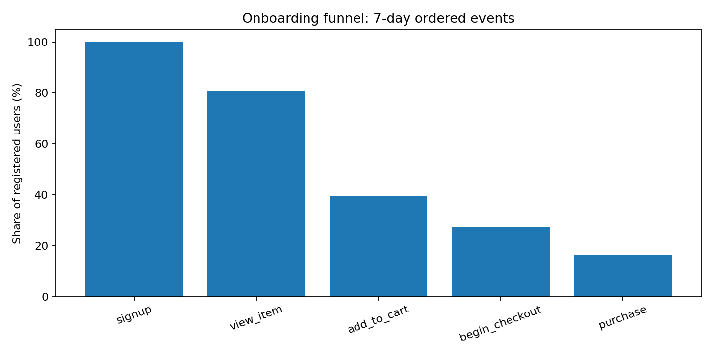
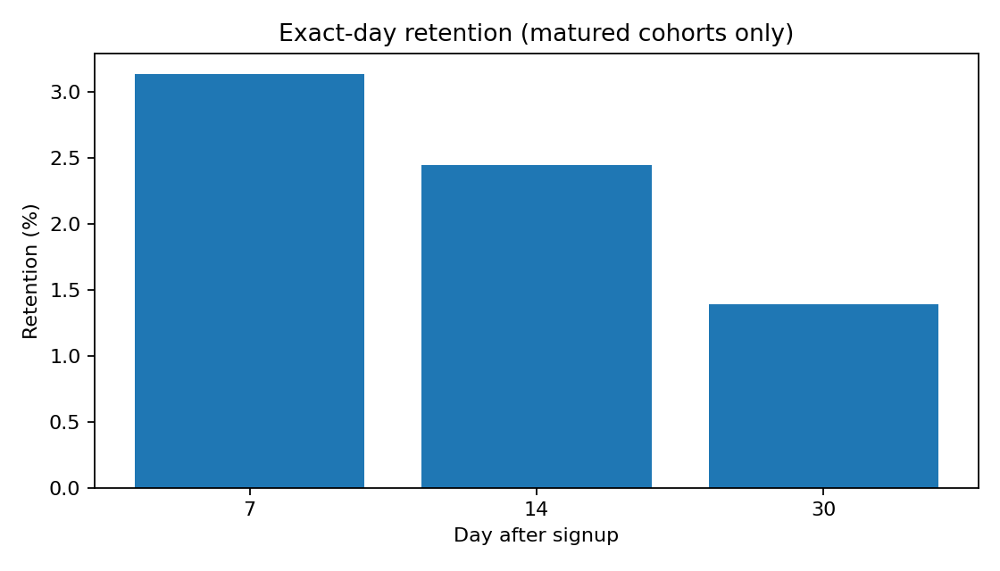
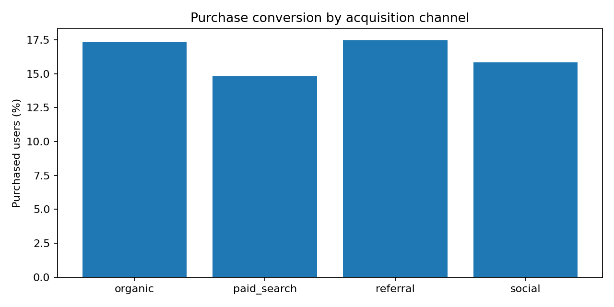

# Marketplace Funnel & Retention Analytics

**Product analytics case study | Python · SQL (PostgreSQL) · pandas · matplotlib · pytest**

> **Data:** Fully synthetic, deterministically generated observations. Results describe a simulated marketplace and do not represent actual customers or measured business impact.

## Business question
A marketplace attracts new users, but which stages of onboarding prevent them from purchasing? How does user retention change, and which acquisition channels show stronger conversion? The goal is to provide a reproducible diagnostic report and a set of testable product hypotheses.

## Key findings on simulated data
- **8,000** registered users, **27,314** tracked events.
- **1,303** users complete purchase within 7 days of signup (**16.29%** of registrations).
- Largest conditional funnel drop: `view_item` → `add_to_cart` (**49.05%** advance).
- Exact day-7 retention **3.14%** (activity during days 7–8 after signup); day-30 **1.39%** of eligible users.
- Channel-level conversion is descriptive, **not** proof of channel causality.







## Recommendations (hypotheses, NOT proven effects)
1. Investigate the product card → cart transition through usability research, page speed checks, item availability, and instrumented funnel analysis.
2. Segment diagnosis by device and channel; avoid assuming channel mix is randomized.
3. Test targeted return-user reminders only after tracking notification exposure, opt-outs, costs, and downstream purchase / user experience metrics.
4. Before any rollout or budget decision, verify data quality, cohort maturity, and the effect on profitable orders (not only conversion).

## How to run
From the **repository root**, with Python 3.10+:

```bash
python -m pip install -r requirements.txt
python src/generate_data.py
python src/analysis.py
python -m pytest -q tests
```

Dataset is already included so you can browse the project without running anything. Generation uses a fixed random seed; scripts recreate the same file and reports. SQL in `sql/analysis.sql` targets PostgreSQL, and assumes you import the CSV into an `events` table (column types described in the SQL file). SQL's simple stage counts are **not** the same as Python's ordered funnel; the difference is deliberately documented.

## What is measured?
- **Funnel:** unique registered users completing five ordered steps within seven days of signup.
- **Purchase conversion:** share of all registered users reaching purchase in that window.
- **Exact-day retention:** any non-signup event between N and N+1 days after signup. The denominator contains only users whose complete observation window has elapsed by Oct 21, 2026.
- **Weekly cohort table:** activity in age-weeks 1, 2 and 3, with only eligible users in denominators.
- **Channel breakdown:** overall unique buyers, sales and average revenue per registered user (ARPU); these are observational summaries.

## Repository structure
```text
data/events_synthetic.csv           Event-level simulated dataset
src/generate_data.py                Reproducible generator
src/analysis.py                     Metrics and visualizations
sql/analysis.sql                    PostgreSQL queries
notebooks/walkthrough.ipynb         Reproducible analysis notebook
figures/                            Pre-generated charts
reports/                            CSV summaries, JSON summary, findings
reports/findings_ru.md              Business interpretation (Russian)
tests/test_analysis.py              Automated checks
requirements.txt                    Dependencies
```

## Limitations
- Simulation models a simplified funnel; synthetic rates should not be treated as benchmarks.
- Purchase event revenue is gross simulated revenue, not profit. There is no CAC, refunds or costs.
- Exact-day retention is intentionally stricter than the often-used week-N retention.
- SQL stage-presence query and Python step-order logic are different metrics: do not compare them without matching definitions.

